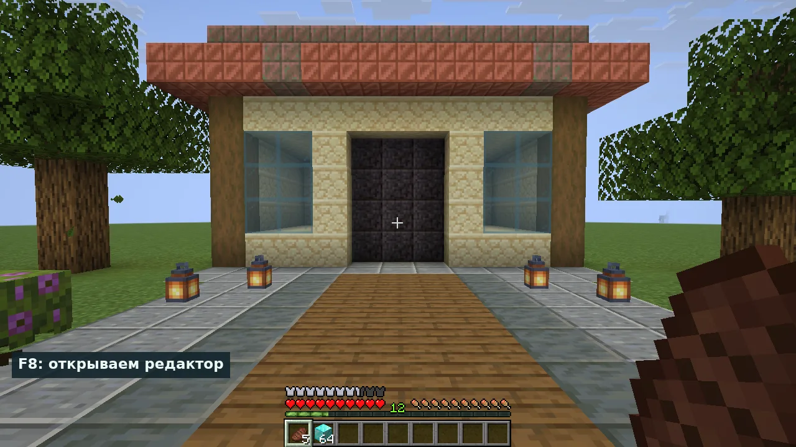
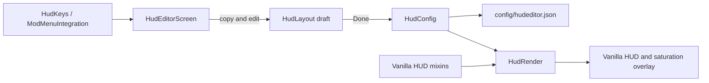

<div align="center">
<h1>HUD Editor</h1>
<hr>
<b>3 controls in one place: HUD layout, opacity, saturation overlay.</b>
<br><br>


<br>
<a href="https://github.com/hhhhhffd/HudEditor/releases/latest"></a>

<a href="LICENSE"></a>
<br><br>
<a href="https://github.com/hhhhhffd/HudEditor/releases">Download</a> · <a href="#architecture">Architecture</a> · <a href="#build">Build</a>
</div>



## Overview

HUD Editor is a client-side Minecraft mod for moving vanilla HUD groups and adjusting their opacity. A draft editor keeps changes separate until saved; a saturation overlay follows the hunger display.

## Technical stack

| Area | Technology |
| --- | --- |
| Core | Minecraft Java 1.21.11, Fabric Loader 0.18.4+, Java 21+ |
| Build | Fabric Loom 1.13.6, Gradle wrapper 9.2.1, official Mojang mappings |
| Optional | Mod Menu 17 (compiled against 17.0.1) |
| Data | Local JSON configuration |

## Architecture



- `HudEditorScreen` edits a copy of `HudLayout`, with up to 64 undo snapshots; Done saves it, while Cancel discards it.
- `HudConfig` keeps a live layout and persists it as JSON. Positions are stored as offsets relative to screen dimensions, and loaded values are clamped.
- Mixins route vanilla HUD drawing through `HudRender`; the master and per-group opacity combine, while saturation is a separate hunger overlay.

## Project structure

```text
.
├── build.gradle          # Fabric Loom build
├── gradle/               # Gradle wrapper configuration
├── src/
│   ├── client/           # Editor, rendering and mixins
│   └── main/             # Mod metadata and resources
├── tests/                # Standalone math checks
└── docs/media/           # Preview image
```

## Setup and usage

1. Install Minecraft Java 1.21.11 with Fabric Loader 0.18.4 or newer and Java 21 or newer.
2. Download the JAR from [releases](https://github.com/hhhhhffd/HudEditor/releases) and put it in the client `mods` folder. Fabric API and server installation are not required.
3. Press **F8** in-game. Rebind it under **Options → Controls → Key Binds → Miscellaneous → Open HUD Editor**. Alternatively use **Mod Menu 17 → HUD Editor → Configure**.

Drag hearts, hunger, armor, hotbar, XP bar, and XP level separately; select a group from the toolbar or its preview. Arrow keys nudge the selected preview when no text/control is focused; Shift moves five pixels. Undo or Ctrl+Z reverses an edit. Reset HUD restores defaults in the draft; Done saves; Cancel or Esc discards it.

Armor and XP bar visibility are independent; hiding the bar leaves the XP level available. Vanilla locator and mount/jump bars remain independent. The vanilla HUD's normal mode and F1 behavior are retained.

The master HUD opacity fades movable groups, including hotbar icons and their count/durability; each group's opacity is multiplied by the master. It also dims vanilla air, vehicle hearts and crosshair sprites, but not other mods' HUDs, chat, sidebar, the world, or UI screens.

Saturation controls a translucent gold layer on hunger icons, following their position and opacity; 0% disables it.

> [!NOTE]
> Saturation uses the latest value synchronized by vanilla for the local player. On an unmodded multiplayer server, changes above zero can appear late when neither hunger nor health updates.

## Configuration

Settings are stored locally in `config/hudeditor.json`. Defaults retain vanilla positions, use 100% master and per-group opacity, 38% saturation opacity, and show armor and the XP bar. Opacity values are percentages from 0 to 100.

## Build

Use Java 21:

```sh
./gradlew build
```

On Windows use `gradlew.bat build`.

<details>
<summary>Standalone math checks</summary>

```sh
javac -d build/hud-tests src/client/java/com/hudeditor/{HudLayer,HudLayout,HudMath}.java tests/HudMathTest.java
java -cp build/hud-tests HudMathTest
```

</details>

## Links

- [Source](https://github.com/hhhhhffd/HudEditor)
- [Preview](docs/media/preview.webp)
- [Releases](https://github.com/hhhhhffd/HudEditor/releases)

## License

[MIT](LICENSE).
